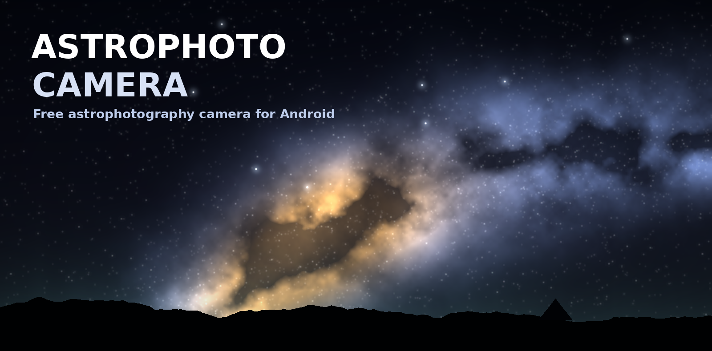

# AstroPhoto Camera

A free astrophotography camera for Android: manual shutter / ISO / focus, RAW (.dng) saving,
calibration frame folders (Lights, Darks, Flats, Bias), intervalometer, histogram and lens switching.
Built for friends, sideloaded APK, no ads.

Roadmap: lens switcher testing, live stacking, viewfinder stacking preview, layout customisation.
